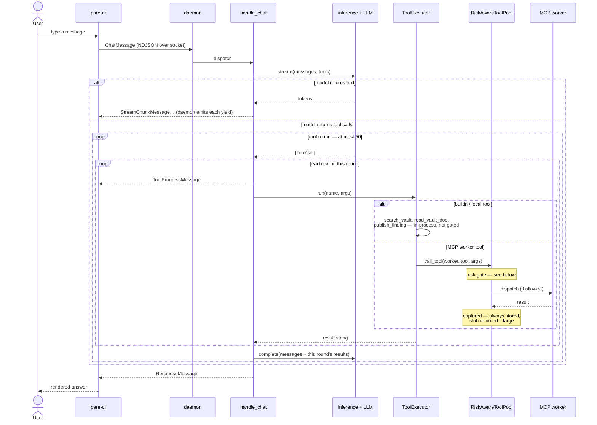
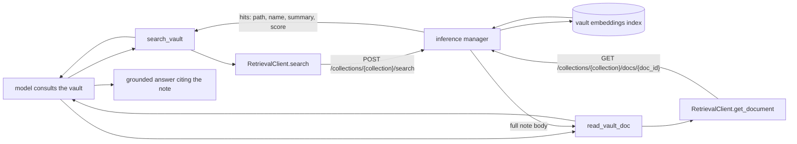
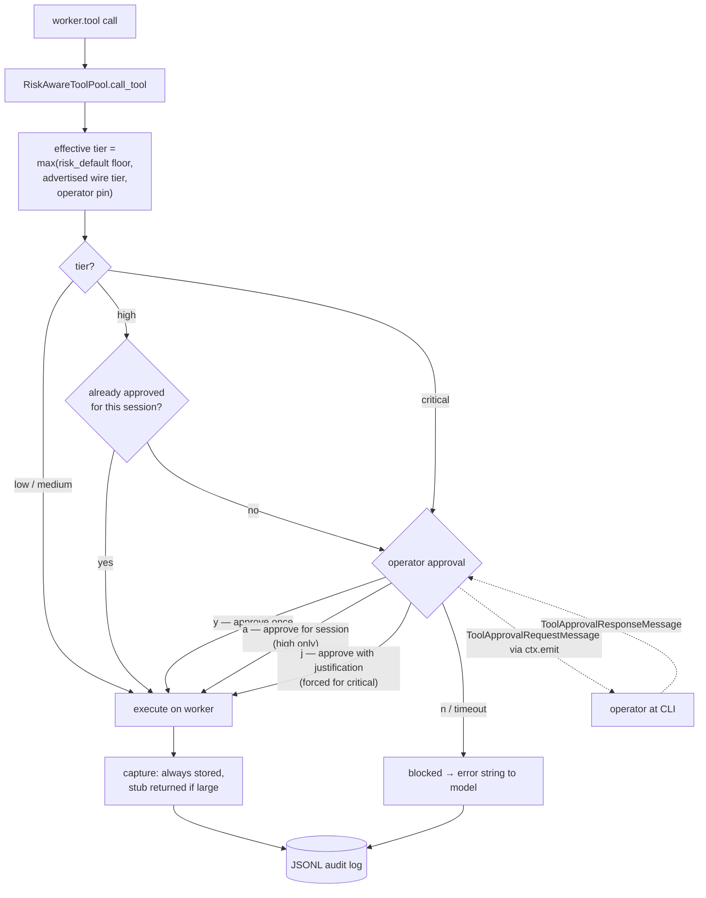
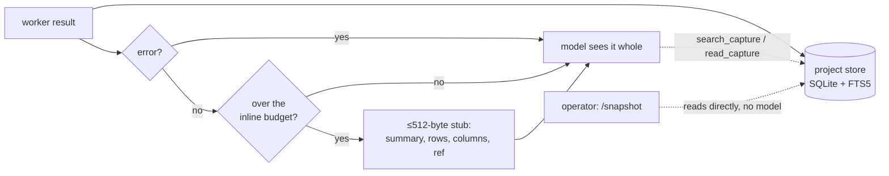
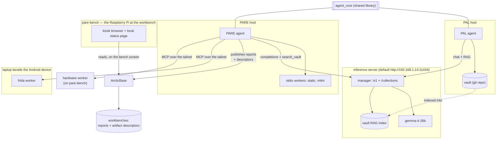

# PARE architecture

How the pieces fit and where the code lives. For what PARE *is*, see
[`README.md`](README.md); to get it running, [`QUICKSTART.md`](QUICKSTART.md);
for the risk model and worker registry, [`WORKERS.md`](WORKERS.md).


PARE is a **daemon + thin client**: `python -m pare` runs the long-lived agent
that binds a Unix socket; `pare-cli` is a REPL that connects to it. The agent is
a thin subclass of [`agent_core`](https://github.com/EdibleTuber/agent_core)'s
`Agent` — most machinery (inference, conversation, tool execution, risk gating,
worker discovery) lives in the shared library.

### A chat turn

A message streams through `handle_chat`, which loops between the model and tools
until the model returns a final answer. Everything `handle_chat` yields is
emitted to the client by the daemon; risk gating and operator approval happen
transparently inside tool dispatch.

The two loops are nested and are not the same thing: `for _round in
range(MAX_TOOL_ROUNDS)` (`pare/agent.py:437`) is the round, and each round runs
every tool call the model asked for before going back to the model. The round cap
of 50 is *"a coarse final backstop"* in its own words (`:356`) — the repeat-guard
and the handback checkpoints are what normally stop a loop, long before it.



### Reading PAL's research vault (RAG)

PARE consumes PAL's knowledge over the inference server's retrieval API — no
shared filesystem required. `search_vault` finds notes by meaning; `read_vault_doc`
pulls a hit's full body.



### Risk gating & operator approval (HITL)

Every **MCP worker** tool call flows through `RiskAwareToolPool`, which resolves
an effective tier and gates high/critical calls on operator approval, auditing
every dispatch. (Builtin/local tools like `search_vault` run in-process and are
not gated.)



**`critical` never takes the session shortcut** — `risk_pool.py:414` reads
`if effective != "critical" and self.is_session_approved(...)`, so a critical tool
prompts every time and requires a typed justification. That branch was missing
from an earlier version of this diagram, which showed `high` and `critical`
behaving identically.

### The capture store

What it is for — context spent only on what the model asks for — is in
[`README.md`](README.md#the-capture-store-context-spent-on-what-the-model-asks-for).
This section covers how it works. The machinery is `agent_core.capture`. PARE
supplies the inline budget and works out which store to use.



- **Storing never depends on size.** `RiskAwareToolPool` passes every result it
  executes to `CaptureLayer.maybe_substitute`, errors included. Calls that were
  denied are not captured, because no tool ran. The layer writes the result
  first and decides about the stub afterwards. In its own words, *"Store !=
  Substitute"*.
- **Only replacing it in the conversation depends on size.** A result larger
  than the inline budget is replaced by a stub from `build_stub`. The stub is
  JSON, capped at 512 bytes, with a `read_capture(ref=…)` hint. Errors are
  never stubbed, because the model has to see them. PARE works out the budget
  in `PareAgent.setup` as `context_window_tokens / history_depth * 3.5` bytes,
  so it shrinks or grows with the context window.
- **Rows come from the result's shape.** `infer_rows` turns a list into one row
  per element. It also unwraps a worker envelope such as
  `{"summary": …, "processes": [...]}` into the list's rows. Hex addresses are
  pulled out at write time (`normalize_addrs`) so they can be searched.
- **Getting results back.** `search_capture` does full-text search across every
  worker, and with no arguments it lists the most recent captures.
  `read_capture` returns one capture as a byte window that can be paged with
  `offset`. Both are built-in tools and run outside risk gating. A ref that no
  longer exists returns a hint to search again rather than an error.
- **Where the store lives.** `resolve_capture_db` walks up from the client's
  working directory looking for a `.pare/` folder. It stops before `$HOME`, so
  a marker in `$HOME` itself is ignored. The store is then
  `.pare/capture.db`, so each project gets its own. Outside a project it falls
  back to a per-session database under XDG state. `pare/capture_store.py` opens
  each store once, adds a `.gitignore` to it, and holds an advisory lock so a
  second daemon on the same project fails loudly. A body over 64 KiB is
  written out to a separate file, but full-text search still covers it.
- **`/snapshot`** (`pare/commands/snapshot.py`) shows a capture to the operator
  in full. It reads the store directly and draws the table itself, so the model
  never sees it. Operator Frida commands such as `/ps` and `/apps` call the
  pool with `capture=False`. Their results are still stored, but the operator
  sees all of the output rather than a stub.
- **The TUI's pane activity is captured too.** Console traffic from the TUI
  panes is written to the same store under `worker="pane:<kind>"`, off the
  daemon's event loop. That makes it searchable alongside tool output.

### Ecosystem

PARE is the second agent on `agent_core` (after PAL). PAL curates the vault;
the inference server indexes it for RAG; PARE reads it and drives RE workers.



**These are roles, not machines.** On this deployment the inference server, the
PARE daemon and ArcticBase are all the same host (`agenthost`). The bench Pi
(which also runs the hardware worker) and the laptop running the frida worker
are genuinely separate. The split is drawn because nothing in the design assumes
they are co-located — the Pi reaches ArcticBase over the tailnet, which is why
`PARE_ARCTICBASE_URL` is pinned to a tailnet address in the deployed unit rather
than to loopback.

## Layout

```
pare/
    agent.py            PareAgent — handle_chat / handle_command / setup / system_prompt
    __main__.py         python -m pare entry point (calls run_daemon)
    cli.py              pare-cli — wires agent_core's REPL to PARE's socket
    config.py           PAREConfig (PARE_* env vars)
    arcticbase.py       ArcticBase client — workbenches, reports, descriptors
    capture_store.py    per-project capture store (.pare/ walk-up)
    project_slug.py     one slug for workbench, captures and artifacts
    heartbeat.py        liveness the bench status page reads
    handback.py         operator-handback checkpoints
    repeat_guard.py     no-progress floor on repeated tool calls
    prompts/system.md   the RE loop as the model runs it
    commands/           /health /worker /mitm /snapshot /frida … (one module each)
    tools/              publish_finding, read_vault_doc, static_analyze, _http
workers.yaml            MCP worker registry and the trust anchor — see WORKERS.md
bench/                  the Pi at the bench: status server, kiosk + status units
deploy/                 the units and compose overrides that are actually deployed
scripts/                bench deploy/doctor, live worker + command smokes
tests/
docs/
    superpowers/        designs, plans and build records
    *-quickstart.md     frida and mitm walkthroughs
```

This is a **map, not an inventory** — `git ls-files` is the inventory, and a tree
transcribed into prose goes stale the first time a module is added. What it is
for is showing which part owns which concern.

MCP-discovered tools are registered at startup by `PareAgent.register_tools()` and dispatched through a `RiskAwareToolPool`, so every worker tool call is risk-evaluated and audited.

