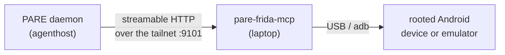
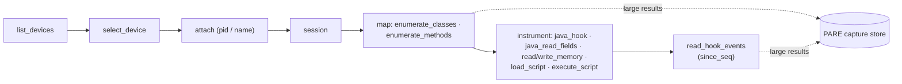

# PARE + Frida Quick Start

Drive **Frida dynamic instrumentation** (Android) through PARE. You can discover
devices, attach to a process, enumerate and hook Java classes, read object state
and memory, and run scripts, all by conversation. Every dangerous action waits
for your approval, and every call is audited.

This builds on the base [`QUICKSTART.md`](../QUICKSTART.md) (inference server,
vault, daemon, CLI). Read that first; this guide adds the Frida worker.

## Where the worker runs

The Frida worker runs **on the machine the Android device is plugged into**,
usually a laptop, not on the PARE host. It serves MCP over HTTP on the tailnet,
and the daemon connects to it as a networked worker:



The worker is [`pare-frida-mcp`](https://github.com/EdibleTuber/pare-frida-mcp),
which targets Android with Frida 17. It is **not** a PARE dependency: it is
installed on the laptop, not into PARE's venv. PARE registers its tools as
`frida_<tool>`.

## What the worker provides

`/worker tools frida` lists what the loaded worker exposes right now. The
worker's own `contract.py` is the source of truth for names and tiers. In
broad strokes:

| Wire tier | Tools | Effect |
|---|---|---|
| low | `list_devices`, `select_device`, `list_sessions`; `enumerate_*` (processes, apps, modules, exports, classes, methods); `read_hook_events`; `java_hook_remove` | auto-execute, audited |
| medium | `attach`, `detach`, `load_script` | auto-execute, audited |
| **high** | `java_hook`, `java_read_fields`, `read_memory`, `write_memory` | prompt for approval |
| **critical** | `execute_script` (arbitrary JS) | prompt every time, justification required |

`workers.yaml` also pins `frida_execute_script` to critical and
`frida_write_memory` to high. Those pins hold even if a worker build
under-reports its tiers.

Large results, such as a class list or an export table, go into PARE's
**capture store**, not the conversation. The model gets a short stub and pulls
back only what it needs with `search_capture` / `read_capture`. See
[`ARCHITECTURE.md`](../ARCHITECTURE.md#the-capture-store).

> **iOS, SSL/root/JB bypasses, the script vault and `scan_memory` are not in
> v1.** They are tracked as follow-ups in the worker's design spec.

## 1. Prerequisites — on the laptop

- **A `pare-frida-mcp` checkout, installed into its own venv.**
  `git pull` does not install new dependencies, so run the install again
  after pulling:
  ```bash
  cd ~/path/to/pare-frida-mcp
  git pull
  pip install -e ".[dev]"
  ```
  This does not install `agent_core`. That is deliberate: the daemon side stays
  on the PARE host, and the tests that need it skip.
- **A rooted Android target**: a physical device or an emulator (e.g. a rooted
  AVD or Genymotion), connected over `adb`.
- **`frida-server` on the target, matching the laptop's Frida version:**
  ```bash
  python -c "import frida; print(frida.__version__)"   # in the worker's venv
  # download frida-server-<that version>-android-<arch> from the Frida releases
  adb push frida-server-<version>-android-arm64 /data/local/tmp/frida-server
  adb shell "chmod 755 /data/local/tmp/frida-server"
  adb shell "su -c '/data/local/tmp/frida-server &'"
  ```

Check that Frida sees the device **before** involving PARE:

```bash
frida-ls-devices      # should list your device
frida-ps -U | head    # processes on the USB device
```

If these fail, fix the device or `frida-server` first. PARE can't work around it.

## 2. Serve the worker on the tailnet

The worker serves HTTP when `pare-worker-kit`'s environment variables ask it to:

```bash
AGENT_WORKER_TRANSPORT=http AGENT_WORKER_HOST=tailscale0 AGENT_WORKER_PORT=9101 \
  pare-frida-mcp
```

- **`AGENT_WORKER_HOST` takes an interface name.** Use `tailscale0` rather
  than an address, so the worker isn't left behind when the tailnet assigns a
  new address.
- **A wildcard bind is refused.** The worker has no authentication; the bind
  address is the access control. Every spelling of the wildcard (`0.0.0.0`,
  `::`, `0`, …) exits non-zero rather than exposing every Frida tool to every
  network the laptop joins.

To keep it running across reboots, use a systemd unit. **Generate the unit
rather than pasting a template.** A placeholder `User=` line that survived into
a real unit failed with `217/USER`. The procedure is §1.5 of
[`superpowers/2026-09-06-networked-frida-smoke-test.md`](superpowers/2026-09-06-networked-frida-smoke-test.md).

## 3. Load it in PARE

`workers.yaml` already declares the worker. Set `endpoint` to your laptop's
tailnet address:

```yaml
workers:
  frida:
    endpoint: http://100.68.47.23:9101/mcp     # the laptop's tailnet address
    transport: streamable_http
    connect_timeout: 20
    read_timeout: 60
    risk_default: low
    autoload: false        # REQUIRED — see below
    capability_tags: [mobile, dynamic, android, frida]
```

- **`autoload: false` is required, not a preference.** A sleeping laptop does
  not refuse a connection; it silently drops it. An autoloading networked
  worker would therefore cost its full connect timeout at every daemon boot
  (`docs/superpowers/specs/2026-09-05-networked-workers-design.md` §5.3). Load it when you need it, with no restart:
  ```
  /worker load frida
  /worker tools frida      # confirm the frida_* tools registered
  ```
- **`risk_default: low` is a floor, not a ceiling.** The effective tier of
  each call is `max(floor, the tool's wire tier, operator pin)`, so the tiers
  in the table above apply. See the risk-gating diagram in
  [`ARCHITECTURE.md`](../ARCHITECTURE.md#risk-gating--operator-approval-hitl).

## 4. Operator commands — no model in the loop

To look at or set up the device yourself, these commands call the worker
directly and print the full result. They are still audited, and the result is
still stored in the capture store:

| Command | Does |
|---|---|
| `/devices` | list Frida devices |
| `/select <device_id>` | select a device |
| `/ps [<device_id>]` | list processes |
| `/apps [<device_id>]` | list installed apps |
| `/attach <target> [<device_id>]` | attach by pid or name |
| `/sessions` | live sessions, with a liveness probe |
| `/detach <session_id>` | detach and tear down the session's state |
| `/snapshot [list \| <ref> [query]]` | show any capture from the store in full |

## 5. The session lifecycle



Three behaviours that read as failures but are not:

- **Classes load lazily.** Navigate into the screen you care about *before*
  `enumerate_classes`. The filter is a case-insensitive substring of the loaded
  Java package, which can differ from the app id.
- **A hook buffers its events.** Call `read_hook_events` with the last `seq`
  you saw (0 the first time) to get new ones. An empty read means "not
  triggered yet". Trigger the action in the app and read again.
- **A tool that takes a `session_id` uses the most recent live session** when
  it is omitted. With nothing attached, it says to attach first.

## 6. A guided session

Low and medium calls auto-execute. Calls from `high` up stop at the approval
prompt: `y` once · `n` deny · `j` approve with justification (required for
`critical`) · `a` approve this tool for the rest of the session (`high` only;
`critical` always prompts again).

```
> List the Frida devices and attach to com.example.targetapp.

  → frida_list_devices                       (low — runs)
  → frida_attach name=com.example.targetapp  (medium — runs)

Attached. Session sess-1 is live on com.example.targetapp.

> Hook android.app.Activity.onResume and tell me when it fires.

--- approval required ---
  frida.java_hook  (declared=high effective=high)
  args: session_id=sess-1, cls=android.app.Activity, method=onResume
  approve? [y/n/j/a]: a        # approve java_hook for the rest of this session

Hook installed. Navigate the app, then ask me to read the events.

> Did it fire?

  → frida_read_hook_events since_seq=0       (low — runs)
  → 3 events: onResume (MainActivity), ...
```

`execute_script` is **critical**. PARE requires a justification before running
arbitrary JS in the target, every time:

```
> Run a quick script to dump the app's loaded class loaders.

--- approval required ---
  frida.execute_script  (declared=critical effective=critical)
  args: session_id=sess-1, source=Java.perform(() => { ... })
  approve? [y/n/j/a]: j
  justification> investigating classloader hierarchy for hook targeting
```

Every call (approved, denied or auto-executed) is appended to the JSONL audit
log under `PARE_AUDIT_DIR` (default `~/.local/share/pare/audit/`).

For a worked solve, see
[`walkthroughs/omtg-datast-001-keystore.md`](walkthroughs/omtg-datast-001-keystore.md).

## Troubleshooting

| Symptom | Cause / fix |
|---|---|
| PARE says it has no Frida tools | The worker is declared with `autoload: false`. Run `/worker load frida`, then `/worker tools frida`. |
| `/worker list` shows frida `UNREACHABLE`, or the load takes `connect_timeout` and fails | The laptop is asleep or off the tailnet, or the worker isn't serving. On the laptop, `curl -sS -o /dev/null -w '%{http_code}\n' http://<tailnet-ip>:9101/mcp` should print any status. |
| The worker exits at start with a message about the wildcard | `AGENT_WORKER_HOST` resolves to a wildcard. Use `tailscale0` or the tailnet address. |
| `frida_list_devices` returns nothing, or errors about the server | `frida-server` isn't running on the target, or its version doesn't match the laptop's `frida.__version__`. Push the matching server again. |
| `attach` fails with "process not found" | Use the exact package or process name (`frida-ps -U`, or `/ps`), or launch the app first. |
| `enumerate_classes` misses the app's classes | Classes load lazily: open the screen first. Or filter on a short token; the Java package can differ from the app id, including in case. |
| `read_hook_events` is empty right after hooking | Not triggered yet. Do the action in the app, then read again from the same `since_seq`. |
| A result came back as a small `captured` stub | Working as intended: the full result is in the capture store. The model reads it with `read_capture`; you can view it with `/snapshot <ref>`. |
